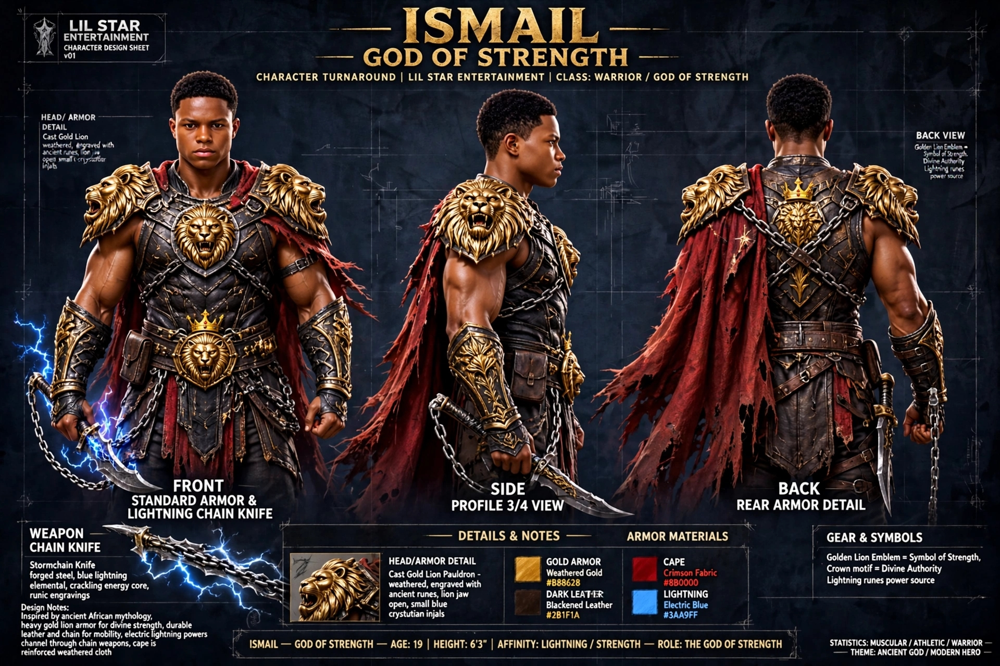
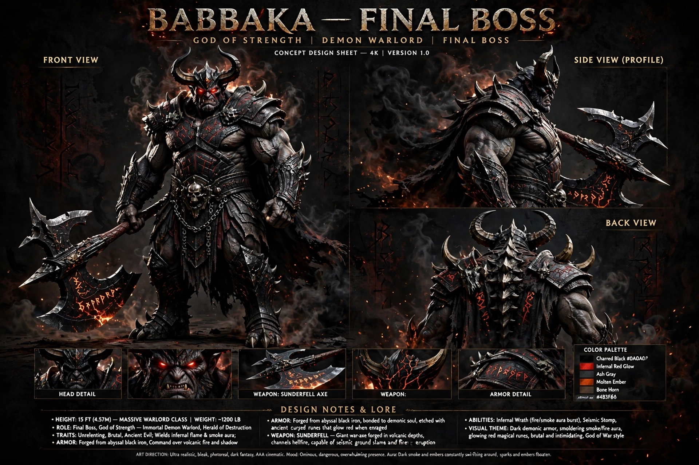

# GOD OF STRENGTH - ISMAIL SAGA
### A Lil Star Entertainment Presents

**One Warrior. Five Temples. One Final Battle.**

---

### 🎮 STARRING YOU AS ISMAIL
You are **Ismail - God of Strength**, the Lion Warrior with beard and traditional armor. Fight to defeat the final boss **BABBAKA**!

**Game Features:**
- 🗡️ Ghost of Sparta Style Combat
- 🏛️ 5 Temples to Conquer
- 👹 Final Boss: BABBAKA (Big Demon)
- 🎚️ Difficulties: Easy / Hard / Very Hard
- 🎬 10 Sec Intro: Lil Star Entertainment Logo

---

### 📸 GAME ART - YOUR FACE AS GAME CHARACTER

#### Main Cover (ICON0)

*Ismail as God of Strength with GOD OF STRENGTH title and Babbaka behind*

#### Menu Background (PIC1)

*Close up serious face - Lion Warrior*

#### Character Design Sheet

*Front / Side / Back View*

#### Final Boss

*BABBAKA - The Final Demon*

> **Note:** If pictures no show, check exact IMG names for your repo and update names above.

---

### 📂 FILES IN THIS REPO
- `main.c` - Main game code (Ghost of Sparta engine)
- `Makefile` - Build file to create EBOOT.PBP
- `IMG-*.jpg` - Game art with your face as Ismail
- `.github/workflows/build.yml` - Auto build system
- `README.md` - This file

---

### 📱 HOW TO PLAY ON ANDROID (Oukitel WP19)

1.  Go to **Actions** tab → Download **God-Of-Strength-PSP** artifacts zip
2.  Extract → You get `EBOOT.PBP`
3.  On phone, create folders: `PSP/GAME/GodOfStrength/`
4.  Put `EBOOT.PBP` inside `GodOfStrength`
5.  Install **PPSSPP** from Play Store
6.  Open PPSSPP → Games → Find `God of Strength` → **PLAY!**
7.  You go see YOUR FACE as Ismail for PSP!

---

### 🏗️ HOW TO BUILD EBOOT.PBP

```bash
make
# This creates EBOOT.PBP with ICON0 and PIC1
